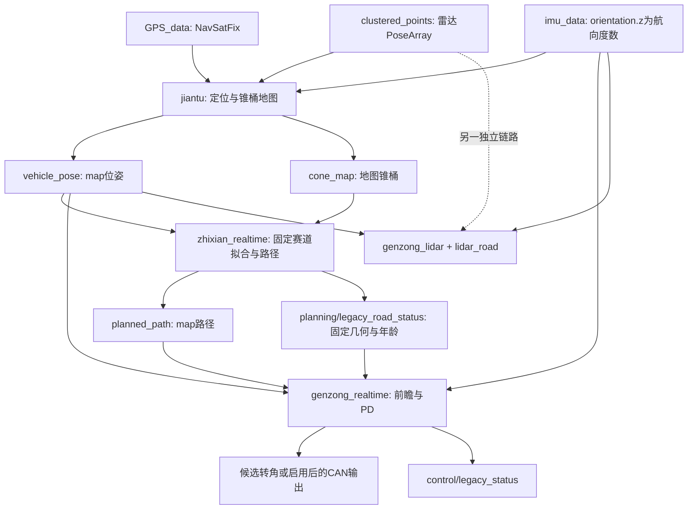
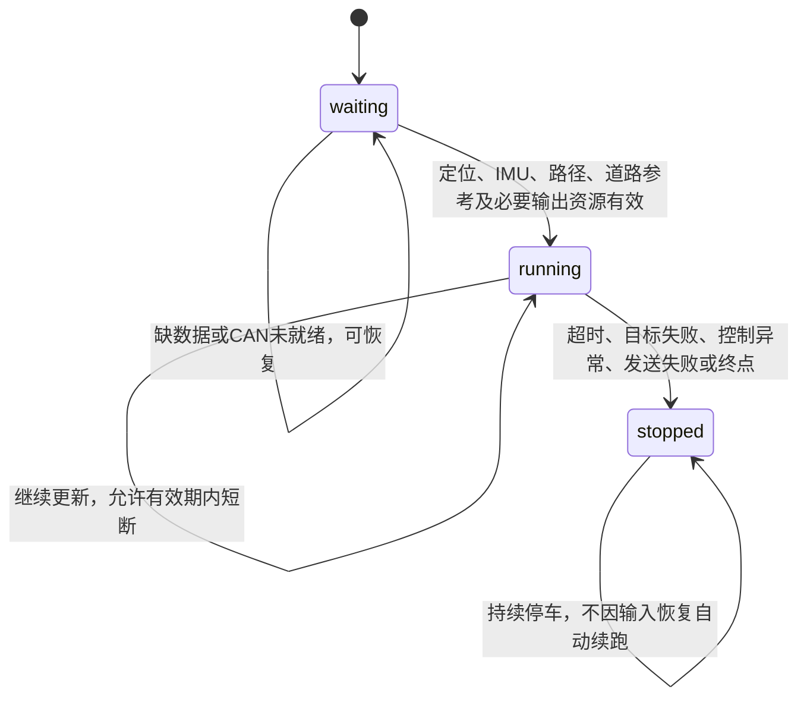

# 项目逻辑分析

本说明以2026-10-19工作区的实际代码为准，重点解释旧版直线链路，并对照雷达融合版。运行命令、构建和报告入口统一放在[整体README](../README.md)。本文件不是实车验收结论。

## 1. 总体分工



融合控制器不订阅旧版路径或锥桶地图来计算横向控制。八字赛项使用`figure_eight_planner`的独立建图、规划和UDP追踪；不能把不同赛项的配置、消息约定或外参直接互换。

## 2. 传感器输入与地图

源码：[IMU驱动](../src/imu/src/daoyuan_simple.py)、[建图节点](../src/acceleration_event/src/jiantu.py)。

### GPS/IMU

`daoyuan_simple.py::main`解码串口INS数据，发布GPS和IMU；消息时间戳使用发布时ROS时间。`orientation.z`直接存储**航向角度**，不是标准IMU四元数的z分量。驱动循环目标10Hz，实际频率还受串口数据到达影响。

`FSAESLAMNode::check_initialization`在初始化等待后锁定GPS经纬度与初始航向。GPS回调先做经纬度范围检查，再投影到初始车辆方向定义的地图；位姿在有效GPS回调后发布。因此高频IMU不等于高频`/vehicle_pose`。

地图X轴沿初始化车头，原点为初始化GPS位置；它不保证与实际赛道中心/方向重合。当前建图不具备旧文档所描述的完整GPS质量状态/协方差准入、GPS-IMU历史插值或定位漂移修正。不要把驱动填入的协方差当作已校准的质量保证。

### 雷达、关联和历史

感知入口 [lidar.launch](../src/lidar/src/lidar_nodes/launch/lidar.launch)连接Velodyne、预处理、地面分割与聚类，当前聚类对直线链路发布`/clustered_points`。建图逐点检查非有限值、转换外参并去除本车范围内的回波，使用最新缓存位姿变到map。

`_merge_cone_unlocked`按最近距离关联，启动配置阈值0.8米；否则创建新桶。`ConeObject.update`保留最多10个观测并加权平均位置，置信度随观测数量增长，初始为0.2。6秒未更新的桶被清理，维护定时器周期0.2秒，但只有清理改变地图时才额外发布，不是恒定5Hz地图流。

地图带历史，不是只包含当前帧。`ConeArray.header.stamp`保存最近非空检测的有效源时间，空帧、维护发布及重复源时间不刷新它；零时间戳兼容接收时间。这是**整图级别**的支持时间，不是每个桶的时间。新杂点可能刷新含旧桶的地图，因此“时间新”不能完全证明几何可信。

## 3. 话题、消息与时间契约

| 话题 | 类型 | 坐标/含义 | 旧版主要消费者 |
|---|---|---|---|
| `/GPS_data` | sensor_msgs/NavSatFix | 经纬度；驱动ROS时间 | 建图 |
| `/imu_data` | sensor_msgs/Imu | 自定义航向度数存orientation.z | 建图、控制器有效性检查 |
| `/clustered_points` | geometry_msgs/PoseArray | 雷达`velodyne`，Z为几何高度 | 建图；融合版直接消费 |
| `/vehicle_pose` | geometry_msgs/PoseStamped | `map`位置与相对航向四元数 | 规划、控制器 |
| `/cone_map` | mapping/ConeArray | map锥桶x/y/confidence；整图观测时间 | 规划；控制器仍缓存但不再独立拟合 |
| `/planned_path` | nav_msgs/Path | map路径；header是路径发布时间 | 控制器 |
| `/planning/legacy_road_status` | std_msgs/String | JSON固定几何和观测年龄 | 控制器 |
| `/control/legacy_status` | std_msgs/String | waiting/running/stopped及原因 | 诊断/验证 |
| `/control/legacy_candidate_steering` | std_msgs/Float64 | 无输出时的弧度候选转角 | 观察工具，不是车轮反馈 |
| `/control/steering` | std_msgs/Float64 | 输出开启时的软件转角 | 下游观察；CAN另行UDP发送 |

`mapping/Cone`使用独立`confidence`字段，不把PoseArray的Z当作置信度。旧文档里的`/planning/status`、`/control/input_status`并非本链路的当前状态接口。

旧版同时使用ROS源时间及`time.time()`接收时间。规划器将源年龄换算为接收时钟下的支持时间，控制器接收道路状态时再加传输年龄。它不是“全链路统一单调时钟”实现。正常运行采用一致时间源；ROS仿真时间与墙钟混用、回放跳时仍需专门验证。

## 4. 地图、固定赛道和当前车体三个参考系

源码：[jiantu.py](../src/acceleration_event/src/jiantu.py)的坐标转换；[track_frame.py](../src/acceleration_event/src/track_frame.py)的`TrackFrame`。

| 名称 | 原点 | X方向 | 是否移动 |
|---|---|---|---|
| M：map | 初始化GPS位置 | 初始化车头 | 固定 |
| T：固定赛道 | 首次有效配对时车辆在M中的位置 | 首组锥桶连线法线，选择朝初始车头一侧 | 固定 |
| B：当前车体 | 当前车辆参考点 | 当前车头 | 随车辆平移与转动 |

内部意图均为X前、Y右；雷达原始Y左，经`lidar_y_sign=-1`翻转。Z上与Y右的组合不是常见ROS右手车体约定，消息frame_id或四元数本身不会替你解决物理方向差异。IMU实际正方向、外参参考点及VCU角度正方向仍须实测。

令`R(a)=[[cos(a),-sin(a)],[sin(a),cos(a)]]`，下标明确输入输出：

```text
车体到地图：p_M = vehicle_M + R(vehicle_yaw) p_B
地图到车体：p_B = R(-vehicle_yaw) (p_M - vehicle_M)
赛道到地图：p_M = origin_T_in_M + R(track_yaw) p_T
```

位置用米，规划/控制内部角度用弧度，驱动航向及外参配置角度按代码转换为弧度。`vehicle_yaw`相对M的X轴；`yaw_track_world`是T相对M的方向，不是相对地理北的绝对角。

T原点不强制在中心线上，所以中心线写为`d=k*s+b`，而非强行`d=0`。车头只转10度时，固定道路在M/T内不应变化，但其B系斜率会变化。历史`k/b`必须保留在T中，不能把上一帧车体参数直接当成本帧参数。

## 5. 旧版配对、中心线与平滑路径

源码：[zhixian_realtime.py](../src/acceleration_event/src/zhixian_realtime.py)的`pair_cones`、`estimate_centerline`、`update_centerline`、`generate_local_path`；[track_frame.py](../src/acceleration_event/src/track_frame.py)的`bootstrap_frame`和`paired_centers`。

### 初始化与配对

1. 地图消息须有可用源时间；选取置信度满足阈值的桶。
2. 尚未建立T时，以当前车头方向作临时筛选轴，从一组完整锥桶的法线建立T。**单组即可**，没有新增连续多帧起步要求。
3. 已有T后，候选窗口、纵向差与行间去重全部在T中判断。窗口相对当前车辆赛道纵向位置为-8～25米，横向候选范围为相对车辆±6米。
4. 选近处最多20个桶，配对欧氏距离2～4米、同排纵向差不大于0.8米；评分考虑宽度误差、纵向差与距离。
5. 每个桶只使用一次；不同排中心纵向间隔至少1.5米，最多保留2排。没有强制两个桶在车体Y轴一正一负，车偏到一侧时仍可能配对。

单个桶或只有同侧观测不构成旧版有效完整配对。不要把融合版的单侧短时处理描述搬到旧版。初始化严重歪摆、首排错配或摆放误差仍可能影响T的方向；这不是已标定道路方向。

### 拟合与观测保持

两排中心纵向间距超过0.8米时，拟合T系`d=k*s+b`。`abs(raw_k)>0.06`拒绝整次估计，避免把被拒绝的角度错误挤进截距；没有有效历史线时允许下次重建初始T。该门限约束**固定道路方向变化**，不限制车辆自身只能偏航3.4度。

有效历史方向先受0.02变化限制与0.12权重处理，再由`update_centerline`使用中心线权重平滑；截距还受默认0.35米单次变化限制。只有一排时保持已有T系方向，更新位置。反复处理同一个源观测不继续推动滤波，也不更新最后有效观测时间。

未取得新有效拟合时短时使用旧固定线；规划器仍可能发布新路径，但道路状态带着旧观测年龄，运行中的控制器据此超时停车，不把新发布时间当作新道路证据。

### 路径不是直接中心线

车辆当前T坐标为`(s_v,d_v)`，前向采样为`x`：

```text
offset(x) = clip(k*(s_v+x)+b-d_v, -1.5, 1.5)
alpha(x)  = 0.5-0.5*cos(pi*x/blend)   （x<blend）
            1                       （之后）
path_T(x) = (s_v+x, d_v+alpha(x)*offset(x))
```

再由T变回map并做路径滑动平均。两排`blend=6米`，单排`blend=12米`；长度30米、间隔0.5米，通常61点。路径从车辆当前位置渐变回归，不要求起点就在真实中心线上。

`max_center_offset=1.5`是**生成偏移的裁剪**，不是“车离中心线超过1.5米就自动停车”的准入条件。方向正确也不保证渐变速度适合实车动态。

## 6. 前瞻目标与转向计算

源码：[genzong_realtime.py](../src/acceleration_event/src/genzong_realtime.py)的`check_position_sources`、`find_lookahead_point`、`estimate_local_centerline`、`calculate_errors_from_xy`、`filter_tracking_errors`和`pid_control`。

### 位姿与前视距离

GPS生成的位姿进入缓存；每个20Hz控制周期选取最新完整缓存，不再等待1Hz复制。可选FSSIM状态活跃时优先，超时才使用SLAM缓存。这里名为SLAM的来源实际是当前建图发布的GPS/IMU位姿，不应据名称认为已有独立SLAM定位。

实车速度由位置增量/接收间隔估计并滤波，前视计算使用限幅后的速度：

```text
Ld = clip(2.5 + 0.35*v_mps, 2.5, 4.0) 米
```

15km/h约3.96米；位置不动时估计速度趋近零，Ld约2.5米。`fixed_speed`不等于已向真实VCU下发速度限制。

全局目标从最近路径点开始向前有限搜索，优先选距离接近Ld且至少为0.8Ld的点；找不到时有最远未访问点回退。因此这是基于前瞻距离的点选择，**最终转角不是标准Pure Pursuit轴距曲率公式，而是PD**。

### 两种目标仍有混合

规划器状态包含`frame_origin`、`frame_yaw`、`k`、`b`、`pairs`、`observation_age_s`。控制器派生当前车体中心线，不重新从地图拟合另一条线，也不缓存上一车体系参数来平滑本帧。

车辆T坐标`(s_v,d_v)`，`delta=vehicle_yaw-track_yaw`：

```text
den = cos(delta)+k*sin(delta)
k_B = (k*cos(delta)-sin(delta))/den
b_B = (k*s_v+b-d_v)/den
target_B = (Ld, clip(k_B*Ld+b_B,-1,1))
```

近奇异分母返回无局部目标。局部支持期限0.35秒；有效时，2排权重0.65、1排0.45，与平滑路径全局目标产生的误差混合；无局部目标时退回全局路径。两者同源，不是独立冗余定位。

### 误差与PD

给定map目标相对车辆向量`(dx,dy)`：

```text
e_y   = -dx*sin(vehicle_yaw)+dy*cos(vehicle_yaw)
e_psi = wrap(atan2(dy,dx)-vehicle_yaw)
```

`e_y`是**目标点**的横向坐标，不严格等于车辆到道路的垂直距离；`e_psi`是目标方位角，不是单独拟合的道路航向角。两项会包含重叠的偏航影响。

误差先按0.12权重滤波，再执行横向与方位角PD：横向Kp/Kd=0.60/0.05，方位角=0.20/0.01；微分分别限于±0.60、±0.35。方位角权重随横向误差从0.35增加到1，在0.8米时达到全权重。

合成结果乘`steering_sign=1`，先裁剪±0.50rad，再限制每周期变化±0.012rad。20Hz下名义变化速率约0.24rad/s，不是按真实dt统一定义的执行器速度。0.12滤波达到阶跃90%约需0.9秒；从+0.3rad反向到-0.3rad名义至少2.5秒。这些滞后与动态摆动有关，不能仅通过几何正确性验证。

## 7. 启动、失效与输出状态

源码：[legacy_run_guard.py](../src/acceleration_event/src/legacy_run_guard.py)、控制器的`configure_outputs`、`refresh_output_readiness`、`check_start_condition`、`control_loop`和`send_guard_stop`。



- 不要求先移动，不用GPS静止作为启动故障。软件就绪即自动进入控制，没有独立物理发车信号；起点静止时若已进入running，同样开始检查超时。
- 输出true而本地CAN初始化失败时保持等待，启动前至少间隔1秒重试，状态显示`can_unavailable`。进入控制后的故障不会用自动重连绕过锁存。
- 运行检查定位/IMU0.8秒、路径1秒、道路支持1秒。零时间戳在部分旧输入保留接收时间兼容，不能概括为所有零时间戳都拒绝。
- 全局目标找不到、正常CAN发送失败或控制计算异常也会锁存停车。停车分支先于路径计算执行，不因缺路径直接跳过。
- 锁存后需确认车辆状态并重启节点；节点退出时，若原本开启且CAN可用，也会尝试发送停车。软件重启是否解除VCU内部状态，需车端协议确认。

`enable_vehicle_output=false`时不创建CAN客户端，转角发布到候选话题，故障/退出分支不发送车辆命令。`output_ready=true`在此模式表示“不需要实车输出资源”，不代表VCU连接成功。

### CAN与终点

旧版默认UDP目标`192.168.0.7:20005`，本地11312；0x210数据前两字节为小端uint16，正常转角编码：

```text
raw = round(500 + steering_rad*1000/pi)   （正常范围0～1000）
stop_raw = 2000
```

当前±0.50rad约±28.65度，正常raw约341～659；这是软件编码，不是已测前轮角。UDP发送成功不证明VCU接收或制动执行。

旧版`update_finish_distance`累加相邻控制位姿的欧氏增量，达到75米触发终点。**旧版仍是累计距离，不是赛道纵向投影**；横摆/GPS噪声可能增加累计值，定位冻结可能让进度不足。终点处理在正常路径计算之前可执行。

## 8. 实际生效参数与容易误读的配置

来源：[旧版launch](../src/acceleration_event/launch/acceleration_event.launch)及上述构造/计算函数。重复私有参数以最后赋值为准，不能只读前面的注释。

| 分类 | 当前旧版值 |
|---|---|
| 输出/显示 | 主入口默认true/true；validation强制false/false |
| 地图 | 初始化等待3秒；合并0.8米；保留6秒 |
| 外参 | x=1.76618、y=-0.11304、z=0.42850米，Y符号-1，安装偏航0.5度；2D几何不使用z偏移 |
| 规划 | 10Hz；30米/0.5米采样；最多20桶/2排；置信度最终0.15 |
| 配对 | 宽2～4米；纵向差0.8米；排间距1.5米 |
| 方向 | 固定T斜率0.06；变化限制0.02；方向滤波0.12 |
| 路径 | 单/双排渐变12/6米；偏移裁剪1.5米；默认平滑窗口3 |
| 控制 | 20Hz；Ld=2.5～4米、速度增益0.35；误差滤波0.12 |
| 控制增益 | 横向0.60/0.05；方位角0.20/0.01 |
| 转向 | ±0.50rad；每周期±0.012rad；sign=1 |
| 目标混合 | 双排0.65、单排0.45；局部支持0.35秒 |
| 失效/终点 | 定位与IMU0.8秒；路径/道路1秒；累计距离75米 |

配置陷阱：

- launch写了`centerline_alpha=0.15`，但构造函数实际读取`~new_path_weight`，其默认也为0.15。当前数值相同不代表以后改launch的centerline_alpha会生效。
- 规划器launch中的`total_length`、`local_min_x/local_max_x/local_max_abs_y`、`max_centerline_slope`不参与当前固定赛道拟合计算；实际使用固定T窗口、配对和straight_slope_limit。
- 控制器保留了一些旧地图配对/置信度/斜率参数和辅助函数，但正常局部目标现在直接来自规划器固定几何；不要用这些遗留参数推断仍有独立拟合。
- `max_vehicle_speed_mps=4.1667`主要用于估计/前视限幅，不是实车VCU限速命令。`fixed_speed`主要用于可选FSSIM驱动值，不能据此保证实车速度。

## 9. 雷达融合链路的差异

源码：[genzong_lidar.py](../src/acceleration_event/src/genzong_lidar.py)、[lidar_road.py](../src/acceleration_event/src/lidar_road.py)。它导入旧类复用PD、滤波、前视和CAN方法，**不调用旧构造函数/旧控制循环**。

| 项目 | 旧版 | 融合版 |
|---|---|---|
| 横向观测 | 历史map锥桶，经规划器固定T拟合 | 直接当前PoseArray，经外参/本车过滤与局部窗口 |
| 时间处理 | 最新位姿缓存，整图支持时间 | MotionHistory按雷达时间插值对齐并短时预测 |
| 道路表示 | 固定T系k/b | 与观测时刻运动状态关联的方向/法向偏移，转换到当前车体 |
| 起步 | 一组完整配对即可建立参考 | 默认3个不同有效帧确认；重复帧不增加支持 |
| 单侧 | 不作为有效完整配对兜底 | 需要新鲜已识别双侧先验，不能续期最后双侧寿命 |
| 控制目标 | 平滑路径与局部目标混合 | 单一当前道路前瞻目标，无旧路径混合 |
| 纵向进度 | 累计欧氏距离 | 在就绪时锁定起点/方向，投影到固定轴 |
| 输出默认 | 主入口true | shadow+false，不创建CAN |
| 状态/日志 | legacy_status、控制CSV | lidar_status、融合JSONL |

融合位姿要求map frame、非零新鲜时间、近单位四元数及合理增量；雷达要求velodyne frame、有效且递增的时间。IMU仍采用角度协议，运动历史超大间断会使运行失效。

两排中心能更新道路方向，一排主要约束偏移；单侧输入必须与先验边界身份一致。法线式目标为`y=(offset+sin(theta)*Ld)/cos(theta)`并裁剪±1米，方向过大或观测失效时无目标。

主要默认门限：初始化3帧、方向一致性0.35rad、偏移一致性0.5米、边界残差0.25米、定位有效期0.5秒、IMU0.15秒、观测保留0.35秒。它们是实现值，不是实测稳定边界。GPS仍参与速度和进度，融合版不是完全无GPS系统。

## 10. 诊断、验证证据与已知缺口

诊断源码：[run_diagnostics.py](../src/acceleration_event/src/run_diagnostics.py)、[run_diagnostics_core.py](../src/acceleration_event/src/run_diagnostics_core.py)。旁路记录器保存输入与状态，检查缺消息、年龄、空观测、位置疑似静止、融合拒绝、停车锁存和持续大转角；它不会干预车辆。

证据与作用域见[README报告表](../README.md)：

- 已保存81项选定主机回归，不是历史全部测试；未在本次文档整理中重新运行节点或测试。
- 旧版两个业务包在car虚拟机真实构建、导入和无输出启动通过。
- 七项真实ROS检查包括约20Hz持续控制、启动恢复、短空帧、道路/GPS/IMU持续失效及过期IMU时间戳；不能证明真车停稳。
- 未标定车辆模型下，组合偏差和高速延迟仍有失败。对照试验提示变化率限制与滤波的滞后耦合，但候选参数没有覆盖所有场景，未写入生产默认值。

仍需确认：实际轴距、轮角倍率和方向、执行延迟、真实传感器频率与质量、地图漂移/错配、VCU制动反馈和停稳/任务完成状态。没有独立轮速或真实轮角时，不能把GPS静止直接认定为故障，也不能把转角话题当作车轮测量。

## 11. 源码定位速查

| 环节 | 文件与主要函数 |
|---|---|
| 地理投影、外参、地图 | [jiantu.py](../src/acceleration_event/src/jiantu.py)：CoordinateTransformer、cone_callback、publish_cone_map |
| 固定参考系与配对 | [track_frame.py](../src/acceleration_event/src/track_frame.py)：TrackFrame、bootstrap_frame、paired_centers、body_line |
| 估计、平滑路径与道路状态 | [zhixian_realtime.py](../src/acceleration_event/src/zhixian_realtime.py)：estimate_centerline、generate_local_path、_planning_timer |
| 状态刷新、目标、PD、CAN | [genzong_realtime.py](../src/acceleration_event/src/genzong_realtime.py)：check_position_sources、find_lookahead_point、pid_control、CANUDPClient |
| 运行失效锁存 | [legacy_run_guard.py](../src/acceleration_event/src/legacy_run_guard.py)：observe、start、evaluate、stop |
| 当前帧融合 | [genzong_lidar.py](../src/acceleration_event/src/genzong_lidar.py)：process_detection、control_loop；[lidar_road.py](../src/acceleration_event/src/lidar_road.py)：MotionHistory、RoadTracker、Progress |
| 真实ROS集成检查 | [smoke_ros_validation.py](../src/acceleration_event/scripts/smoke_ros_validation.py)、[ros_fault_validation.py](../src/acceleration_event/scripts/ros_fault_validation.py) |
| 离线回归和未标定闭环 | [validate_track_frame.py](../src/acceleration_event/scripts/validate_track_frame.py)、[legacy_loop_validation.py](../src/acceleration_event/scripts/legacy_loop_validation.py)、[analyze_loop_response.py](../src/acceleration_event/scripts/analyze_loop_response.py) |

历史说明中的其他数据质量/终点方案，只能作为[归档记录](archive/2026-10-19/README.md)，不可覆盖这里的实际实现定位。
